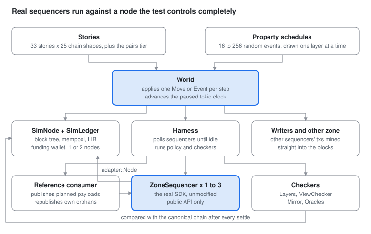

# Zone SDK sim bed: architecture

The sim bed runs unmodified `ZoneSequencer`s against a simulated node on a
paused clock, enumerates every chain shape that matters, and asserts
invariants instead of scripted outcomes. One `cargo test` runs about 2 800
deterministic tests in minutes. This document is the top-down read; the
[README](README.md) is the per-file reference.

## What it is

The bed tests the whole zone SDK sequencer, through its public API only,
against a node the test controls completely. Nothing in the SDK is mocked or
stubbed: the real `ZoneSequencer` connects to a `SimNode` that implements
the same `adapter::Node` trait the HTTP client does, so the SDK cannot tell
the difference. A refactor inside the SDK never touches a test.

The problem it solves is coverage of chain conditions. The SDK's hard cases
are forks, late or duplicate deliveries, a frozen LIB, restarts from a
checkpoint, outages, price moves, and combinations of them in a particular
order. A cucumber run against a real node takes 15 minutes, produces
whichever forks the network happens to produce, and cannot be made to
reproduce a rare one. The bed turns each condition into a named,
deterministic sequence of moves and runs every story on every one of them,
in milliseconds each.

Three properties make that possible:

- **Determinism.** The tokio clock is paused. SDK timers fire only when the
  harness advances time by a known amount, and the harness polls each
  sequencer's `next_event` until it has nothing more to say before the test
  continues. There are no background tasks, so a run is the same every time.
- **Total control of the chain.** The test decides every block: its parent,
  its slot, which posted transactions it takes and in what order, which
  extra transactions go in ahead of them, whether subscribers are told about
  it at all, where LIB stands, and whether old forks are still fetchable.
- **Invariants, not scripts.** Stories assert on what must always hold, such
  as the view equals the canonical chain and every payload finalizes exactly
  once, rather than on a scripted sequence of expected events. That is what
  lets one story run unchanged under 25 chain shapes.

## Two ways a test is made

Everything in the bed is one of two kinds, and they answer different
questions. Deterministic stories run a hand-written scenario on every chain
shape in a fixed catalogue: regression, every known condition, every time.
Property schedules draw the chain, the client conditions and the zone's
actions at random: discovery, the conditions nobody listed. Both run the
same real sequencers against the same simulated node and are judged by the
same checkers.

| | Deterministic stories | Property schedules |
| --- | --- | --- |
| What drives the chain | a catalogue entry: a named cycle of moves, 25 of them, applied step after step | a random list of 16 to 256 events, each drawn with weights from one vocabulary |
| Network | one node; two partitioning nodes on the `partitions` entry | one node three times out of four, two partitioning nodes once |
| Zone actions | scripted in the story: publish here, deposit, fork now, restart there | drawn at random: publishes, bursts, abandons, deposits, withdraws, configs, stops and starts |
| Who composes the forks | the author of the catalogue entry, in advance | nobody; the chain history emerges step by step as the schedule runs |
| What is asserted | the story's own outcome, plus every layer and oracle on every event | invariants only: every planned payload finalizes once in one lineage, pending sets drain, every layer holds |
| Count per run | 33 stories × 25 chains, plus 4 stories × 484 ordered pairs: about 2 780 tests | 5 rungs, 24 to 48 schedules each by default; `PROPTEST_CASES` raises it |
| On failure | the test name says which story on which chain | a shrunk schedule and a replayable seed, which then becomes a story or a catalogue entry |

The sections that follow take them in that order: the step vocabulary both
share, the catalogue and the pairs tier, how a story is written, what the
checkers assert, then the property ladder and how a random failure is turned
into a deterministic story.

## Architecture



Two kinds of input drive one `World`: a story stepping through a chain from
the catalogue, or a property schedule of random events. The world applies
each step to the simulated node and the writers, advances the paused clock,
and lets the harness poll every sequencer until it has nothing more to emit.
The sequencers are the real SDK, talking to `SimNode` through the same
`adapter::Node` trait as the HTTP client; the reference consumer drives them
the way a zone would. After every settle the checkers compare what each
sequencer reported with the node's canonical chain.

## The simulated node

`SimNode` (`src/node.rs`) is one block tree with a mempool, a ledger and a
funding wallet, and it answers every call the SDK can make: the block
stream, LIB stream, immutable blocks by slot range, single blocks and their
events, channel state, consensus and time info, post a transaction, fund a
transaction.

**The ledger** (`src/ledger.rs`) applies the real Mantle channel rules:
inscribe, config, deposit, withdraw and channel transfer, with the
round-robin turn calculation taken from `lb_core`, Ed25519 signatures
verified and ZK proofs trusted. Every transaction pays the real execution
and storage gas from the mainnet gas profile at the node's current gas
prices. A block never carries an invalid transaction: the sim leader evicts
what went stale, as the real one does. Posting validates nothing against the
ledger and re-posting what the mempool already holds succeeds, as on the
real node.

**Why there is a mempool at all.** The SDK does not only read the stream, it
also writes: every publish, re-fund, bundle and config ends in
`post_transaction`, and the test needs those transactions to come back in
blocks or there is nothing to test above the Chain layer. The mempool is
where they wait between being posted and being mined. It is small, a set of
posted transactions in arrival order, and all chain shaping still happens
through the block tree. But inclusion is the test's decision (`TxSelection`
below), reorgs return transactions to it so they re-land a block or two
later, and an outage loses it. Several stories are about exactly those
behaviours.

**What the test controls per block.** `mine_block(BlockSpec)` takes the
parent, the slot, a `TxSelection` (all posted transactions, none, every
other one, or the posted ones in reverse order), extra transactions to put
in ahead of them, and whether the block is announced to subscribers.
Announcing is what makes a lagging subscriber possible: the node can mine
two silent blocks and announce only the third, or announce a sibling while
the real tip moves silently.

**LIB.** The last immutable block trails the tip by the finality depth, 30
blocks as in the deployment's `security_param`, so what is mined but not
finalized lives as long as it does on the network. LIB can also be frozen,
as under the bootstrap fork-choice rule, and thawed later, at which point it
jumps to the tip in one event. Forks below LIB can be pruned so their blocks
are no longer fetchable, fetches can be made to fail a given number of
times, and an event can be delivered twice.

**Mempool and reorgs.** Longest chain wins. When a block is reorged out its
transactions return to the mempool, so a dropped transaction usually
re-lands a block or two later, as the real node readmits them. `node_down`
clears the mempool and the funding reservations, then the node comes back.

**Funding wallet.** The SDK funds its transactions through the node's
wallet, as it does in production. The sim wallet hands out fee notes
largest-first, and a note funded into a transaction is reserved until it is
spent in a block or until LIB has moved 10 blocks past the reservation, then
it is handed out again. That reservation window is what lets the property
tests exercise bundles submitted after their fee note was given away.

**Several nodes.** `import_from` makes one node adopt another's blocks and
`gossip_with` exchanges mempools. The `partitions` chain uses two nodes that
gossip normally, split for two steps every eleven, each mining alone, then
merge so that the primary reorgs onto the peer's branch. Stream handles are
tagged per subscriber, so the test always knows which tip each sequencer has
been told about.

## The vocabulary of a step

The SDK sees exactly one thing: an ordered stream of block events plus the
answers to its own calls. So a network condition is a shape of that stream,
and the bed describes everything the network can do with three small enums
in `src/chains.rs`. One `Move` is one step of the chain and combines one
value of each.

**Shape**, how the chain moves:

| Shape | What happens |
| --- | --- |
| `Extend { gap }` | One block on the tip, `gap` slots later; a gap above 1 leaves empty slots |
| `Fork { depth, length }` | A branch from `depth` blocks below the tip with `length` blocks: longer than `depth` it wins, equal it ties and loses, shorter it stays dormant |
| `Revive { blocks }` | The dormant branch grows by `blocks`, maybe overtaking the tip |
| `Lagging { silent }` | `silent` blocks the node never announces, then one it does |
| `SplitTip` | The tip moves silently and a competing sibling is announced instead |
| `Duplicate` | The tip's event is delivered again |
| `FreezeLib` | LIB stops advancing, as under the bootstrap rule |
| `ThawLib` | LIB catches up with the tip in one jump |
| `Prune` | Forks below LIB are forgotten; their blocks can no longer be fetched |
| `Starve { blocks }` | `blocks` consecutive blocks that take nothing, so LIB moves while everything posted waits and a stale window passes |

**Posted**, what the block takes from the mempool: `All`, `None`, `Half`
(every other posted transaction) or `Reversed` (the posted order inverted,
like a leader ordering differently).

**Condition**, what happens on the client side of the step: `Quiet`; `Drop`
(every block stream closes and the sequencers reconnect); `NodeDown` (the
primary node loses mempool and reservations for a step); `Restart { index,
fresh }` (sequencer `index` restarts from its checkpoint or from scratch);
`FetchFail { count }` (the next `count` block fetches fail); `GasPrice {
price }` (prices move from the next block).

An impossible move resolves the way the network would: a fork deeper than
the chain becomes a plain block, a revive without a dormant branch extends
the tip, a restart of a sequencer that is not running does nothing.

## The catalogue of chain shapes

A chain is a named list of moves applied cyclically: step `n` of the chain
is move `n mod len`. Every story runs on every chain, and `World::step`
applies the next move after advancing the paused clock by a little over a
second so resubmit timers run at their live cadence. Each chain also
promises what it will have shown once a story has run three cycles (a
reorg, a deep reorg, a reconnect, a merge), and `World::finish` checks the
promise, so a chain that stops doing what its name says fails on its own.
The 25 entries in `src/chains.rs`:

| Chain | Cycle | Promise |
| --- | --- | --- |
| `linear` | one block per step | none |
| `empty_slots` | block, gap 3, block, gap 2 | none |
| `half_posted` | every block takes every other posted tx | none |
| `reversed_posted` | every third block orders posted txs in reverse | none |
| `delayed_inclusion` | every fifth block takes nothing, so txs wait a block | none |
| `shallow_forks` | every seventh step a 2-block branch orphans the tip block | reorg |
| `deep_forks` | 34 blocks, then a branch from LIB overtakes the tip, orphaning 30 blocks at once, then 2 blocks | deep reorg |
| `fork_ties` | every fifth step a competing block of the same height takes the mempool and loses | none |
| `dormant_revived` | a short branch sits dormant one block, then grows 3 and wins; 5 plain blocks to finalize | reorg |
| `split_tips` | every fourth step the tip moves silently behind an announced sibling | none |
| `lagging` | every fifth step two blocks go unannounced before one that is | none |
| `duplicates` | every third step the tip's event is delivered twice | none |
| `lib_frozen` | LIB freezes for four blocks, then jumps to the tip; 5 plain blocks | none |
| `forks_pruned` | a losing tie, 3 blocks, prune below LIB, block | none |
| `stream_drops` | every seventh step the streams close before the block | reconnect |
| `node_outages` | every seventh step the node is down for a step | none |
| `restarts` | sequencer 0 restarts from checkpoint at step 6, sequencer 1 at step 12 | none |
| `fresh_restarts` | every sixth step sequencer 0 restarts from scratch, when nothing of its own is pending | none |
| `fetch_failures` | every fifth step the next block fetch fails | none |
| `price_moves` | gas doubles for two blocks, then falls back; what was funded at the old price is evicted | none |
| `fork_after_price_rise` | prices double, then a fork orphans what was funded at the old price | reorg |
| `restart_under_fork` | a dormant branch, sequencer 0 restarts, the branch revives and wins | reorg |
| `drop_under_fork` | a dormant branch, the streams drop, the branch revives and wins | reconnect |
| `forks_under_frozen_lib` | LIB frozen, a shallow fork, a block, a deeper fork, LIB thaws | reorg |
| `partitions` | two nodes gossiping; every eleventh step they split for two steps, the peer gets a block ahead, the merge reorgs the primary | merge |

The last four are orderings that were found to matter and are kept as their
own entries. The finality depth is 30, so `deep_forks` runs 30 plain blocks
after each deep reorg because nothing finalizes between two of them
otherwise.

## The pairs tier

The catalogue tests each condition in isolation or in a few hand-picked
orderings. The pairs tier tests order systematically. `base_conditions()`
lists 22 single conditions, each as one move: empty slots, half, reversed
and nothing posted, shallow fork, deep fork, fork tie, dormant fork, revive,
split tip, lagging, duplicate, freeze LIB, thaw LIB, prune, drop, node down,
restart, fresh restart, fetch fail, price up, price down.

`chains::pair(first, second)` builds a chain whose cycle is: two plain
blocks, the first condition, a plain block, the second condition, a plain
block, a LIB thaw and a price reset so the cycle can repeat, then 30 plain
blocks so what the pair moved can finalize. The `for_each_base_condition!`
macro emits one test per ordered pair, 22 × 22 = 484 chains, and four core
stories run on each: 1 936 tests named `<story>::<first>::<second>`. When
one fails, the name says exactly which two conditions in which order broke
it.

## Stories

A story is an async function that takes a `Chain`, builds a `World` on it,
starts one or more sequencers, drives the world and asserts. The `scenario!`
macro expands it into one test per catalogue entry, named `<story>::<chain>`,
through `for_each_chain!`. A story never says which forks happen; it steps
the world and the chain supplies them. That is why a story must assert
invariants rather than a scripted sequence: the same code must hold on
`linear` and on `deep_forks`.

Every story runs the reference consumer. There are no scripted reaction
policies: how a zone republishes an orphan is the consumer's job, and the
test only asserts on the result.

| Theme (`tests/scenarios/`) | Stories | What they cover |
| --- | --- | --- |
| `publishing.rs` | 12 | messages, checkpoints, same-key instances, turns, a foreign writer, the edge of the stale window |
| `notes.rs` | 10 | deposits, withdraws, pins, refunds, the wallet view |
| `bundles.rs` | 6 | multi-sig rounds, the prepare-then-submit boundary, hand-built custom txs |
| `configs.rs` | 4 | re-keying, orphaning by config, posting timeouts |
| `known_issues.rs` | 6 | stories that began as ignored SDK issues, each the acceptance test of its fix |
| `tiers.rs` | 1 + pairs | the catalogue's self-check (`s00_chain_does_what_it_says`) and the four pairs stories |
| `tests/gas.rs` | | the fee model: paid equals priced, unfunded txs are evicted, price rises are paid |

In numbers: 33 stories × 25 chains, plus 484 pairs × 4 stories, plus the
known-issue and gas tests, about 2 780 tests in one
`cargo test -p logos-blockchain-zone-sdk-testing`.

A story is written against the `World` helpers (`publish`, `deposit`,
`fork`, `steps`, `step_until`, `restart`, `settle_chain`, `finish`) and reads
results from the harness: the checkpoints, the pending payloads, the
indexer's finalized history, the diagnostics dump that every assertion
message carries so a failure prints the chain, the pending sets and the last
events.

## What is checked

Four checkers run inline after every settle, so a violation is caught on
the event that caused it, not at the end of the test.

**The layers** (`src/layers.rs`) are what a sequencer must get right,
stacked. Each layer is only meaningful when the ones below it hold, so every
violation is tagged with its layer and a run reports the lowest broken one.
A broken view would also break the lineage above it; reporting the view
first names the real cause.

| Layer | Invariant |
| --- | --- |
| 1. Chain | The non-finalized view is the canonical chain's channel content, in order, under every chain shape and delivery |
| 2. Lineage | Every finalized tx is reported once, in chain order; each planned payload finalizes once, in one message lineage |
| 3. Configs | The turn view follows the canonical branch's config lineage |
| 4. Notes | The channel wallet is the ledger's note set; deposits are reported once, from canonical blocks |
| 5. Restarts | A sequencer resumed from a checkpoint reports what one that never stopped would |

**The view checker** (`src/view_checker.rs`) checks the `ChannelUpdate`
contract on every event: the prefix, adopted, orphaned, finalized and
pending sets must be consistent with each other and with the chain. Entries
are identified by message id, because the same message lands again under a
new tx hash when it is re-funded or rebuilt, and the contract has consumers
dedup by `this_msg`; entries that carry no message are identified by tx
hash.

**The mirror** (`src/mirror.rs`) is a consumer written the way LEZ consumes
the SDK: it rebuilds the channel view from `ChannelUpdate`s alone, appending
on an extension and rebuilding on a conflict, and is compared with the
node's canonical chain after every settle. If the updates are not enough to
rebuild the view, this is what fails.

**The oracles** (`src/oracles.rs`) check, once a sequencer has caught up
with its node (connected, told about the tip, agreeing on LIB):

- reported deposits come from canonical blocks, and every canonical deposit
  has been reported;
- the channel wallet view equals the ledger's channel notes, finalized
  against LIB and unfinalized against the tip;
- the turn view agrees with the ledger's `round_robin`;
- the finalized history reported is the chain's, once each and in order;
- promptness, judged on the sequencer's two clocks (the stream position and
  the paused tokio time its resubmit timer runs on): every post of an own
  inscription was made after the sequencer's last turn announcement and
  claimed the turn; an own pending inscription chained on the channel tip is
  posted as its owner sees the turn or on the timer's next tick in turn; a
  posted own inscription left unmined is re-funded neither before its
  funding stamp is `stale_refund_slots` LIB slots old nor later than the
  next tick in turn after that;
- a restart from a checkpoint restores every own pending message the chain
  had not finalized, or sheds it as orphaned.

Hand-built txs the test submits whole are exempt from the turn oracles, as
the SDK posts them without a turn.

## The property ladder

The catalogue tests the conditions somebody listed. The property tests
(`tests/properties.rs`) hunt for the ones nobody listed: a scenario is a
list of 16 to 256 events drawn at random from everything the world can do,
applied in order, judged by the layers after every one.

**The event vocabulary** (`src/events.rs`), one `Event` per operation the
world exposes:

| Event | What it does |
| --- | --- |
| `Chain { shape, posted }` | one chain move: any `Shape` with any `Posted` |
| `Client(condition)` | drop, node down, restart from checkpoint or scratch, fetch fail, gas price move |
| `Publish { index, payload }` | sequencer `index` publishes a payload |
| `Deposit` | the user deposits one of its pre-minted notes into the channel |
| `Withdraw { index, amount, unfinalized, delay, retry }` | an atomic withdraw, from finalized notes or any; on a threshold-2 channel prepared now, co-signed, submitted `delay` events later; a refused bundle is re-prepared or dropped |
| `Pin { index, delay, retry }` | pin a deposit, same two-phase round |
| `Config { index, names, timeframe, timeout, threshold }` | a config accrediting the running sequencers plus `names`, with posting rules and a transfer threshold |
| `Custom { index, payloads, priced_out, stale_parent }` | a hand-built tx; `priced_out` is followed by a price rise so it can never land, `stale_parent` chains on a passed message so it must be refused |
| `Abandon`, `Burst`, `Adopt` | a zone's choices: let the next orphan die, publish several at once in turn, republish others' orphans |
| `Stop`, `Start` | stop a sequencer keeping its checkpoint, start it again from it |

A catalogue `Move` and a random event go through the same code:
`World::apply(mv)` is `apply_event(Client(mv.condition))` followed by
`apply_event(Chain { shape, posted })`. A catalogue chain is a fixed list of
events replayed in a cycle; a property schedule is a random list of the
same events.

**How a random network is generated.** Nothing is precomputed; the chain
history emerges as the schedule runs. A `Scenario` is drawn in this order:

1. **The frame.** A base chain: `linear` three times out of four,
   `partitions` once in four. This only decides whether there is one node or
   two gossiping nodes that split and merge every eleventh step; it supplies
   no fork pattern. Then 1 to 3 sequencers, 1 or 2 writers, whether another
   zone runs beside ours, 1 to 4 planned payloads per sequencer, and the
   posting rules (timeframe and timeout, drawn only from the Configs rung
   up).
2. **The length.** 16 to 256 events, or whatever `SIM_EVENTS=min..max` says.
3. **Each event**, from a weighted union of arms. A chain step has weight
   12. Each zone action (publish 2, abandon, burst, adopt, hand-built tx 1
   each) is available from the Lineage rung; a config (1) from Configs;
   deposit 2, withdraw 2, pin 1 from Notes; each client condition (drop,
   node down, restart, fetch fail, price move, stop, start, 1 each) from
   Restarts. An arm above the rung's top layer has weight 0 and is never
   drawn, so about half the events are chain steps at every rung and the
   rest depends on the rung.
4. **A chain step** is a `Shape` and a `Posted`, the same primitives the
   catalogue is built from. Shape weights: extend 10 (gap 1, 2 or 3 at
   6:2:1), fork 3 (depth 1 to 30, length 1 to depth + 1, so wins, ties and
   dormant branches all occur), revive 2, and lagging, split tip, duplicate,
   freeze LIB, thaw LIB, prune and starve 1 each. Posted: all 6, half 2,
   none 1, reversed 1.
5. **Running it.** For each event in order: advance the paused clock by one
   step, apply the event, bring the peer node level if there is one, let
   every sequencer settle. The writers add their traffic in their turns
   throughout, and the checkers judge after every settle.

The catalogue plays no part here. A catalogue entry is a hand-written cyclic
composition of these same steps with a promise attached; a random schedule
is a composition nobody wrote down. What one looks like, with the chain it
produces:

| # | Event drawn | What the node does |
| --- | --- | --- |
| 1 | `Chain { Extend { gap: 1 }, All }` | mines block 1 on the tip with everything posted |
| 2 | `Publish { 0, "p1" }` | sequencer A posts p1 to the mempool |
| 3 | `Chain { Extend { gap: 3 }, Half }` | block 2, three slots later, takes every other posted tx |
| 4 | `Chain { Fork { depth: 2, length: 3 }, All }` | a branch from two blocks below the tip, three blocks long, wins: blocks 1 and 2 are orphaned, their txs return to the mempool |
| 5 | `Deposit` | the user deposits a note |
| 6 | `Chain { Extend { gap: 1 }, None }` | a block that takes nothing |
| 7 | `Client(Drop)` | every block stream closes, the sequencers reconnect |
| 8 | `Chain { Lagging { silent: 2 }, All }` | two blocks nobody is told about, then one announced |
| 9 | `Withdraw { 0, 1, .. }` | sequencer A withdraws 1 |
| 10 | `Chain { FreezeLib, All }` | LIB stops moving |
| 11 | `Chain { Fork { depth: 1, length: 1 }, Reversed }` | a tie: a competing block at the same height, posted txs in reverse order, loses |
| 12 | `Chain { ThawLib, All }` | LIB jumps to the tip |

**The rungs.** The vocabulary is drawn one layer at a time. An arm whose
layer is above the rung's top has weight 0 and is not drawn. The writers'
traffic grows with the rung too: inscriptions only, then configs, then note
transfers, withdraws and two-inscription txs. So each rung is a superset of
the one below, and the lowest failing rung names what the SDK gets wrong.

| Rung | Top layer | Adds to the vocabulary | Cases per run |
| --- | --- | --- | --- |
| `chain_shapes_keep_the_view` | Chain | only other writers' inscriptions on a moving chain; the sequencers publish nothing | 24 |
| `own_messages_land_once` | Lineage | the sequencers' own publishes, bursts, abandons, adoptions, hand-built txs | 24 |
| `configs_move_the_turns` | Configs | config changes, posting rules, writers' configs | 24 |
| `notes_follow_the_ledger` | Notes | deposits, withdraws, pins, two-phase rounds, writers' note moves, the other zone's deposits | 24 |
| `every_schedule_finalizes_each_payload_once` | Restarts | drops, outages, restarts, failing fetches, price moves, stops and starts | 48 |

**How a schedule is judged.** The world is built with a funding wallet
sized to the schedule, the channel opened and the writers accredited, and
the sequencers started with their planned payloads. When the schedule is
over the writers stop, a frozen LIB is thawed, every stopped sequencer is
started again, prepared bundles are flushed, and the chain is given up to
400 steps to settle. Then, in this order: the Chain layer report, every
planned payload finalized exactly once and in one lineage (an abandoned
payload, a pin or a hand-built tx may land once but never twice), and the
Restarts layer report. Only invariants, never a scripted expectation.

## Shrinking and seeds: from a random failure to a story

**What shrinking is.** Proptest does not just generate a random value; every
strategy produces a value together with a recipe for making it simpler. For
a vector that means fewer elements; for a number, a smaller one; for an enum
drawn with `prop_oneof!`, an arm listed earlier (which is why the plain
`Extend` arm comes first in `shape()`). When a schedule fails, proptest asks
the recipe for a simpler schedule and runs it again. If it still fails, that
becomes the new candidate; if it passes, proptest backs off and tries a
different simplification. It stops when nothing simpler fails, or at
`max_shrink_iters` (200) or `max_shrink_time` (120 s), whichever comes
first. The result printed is the smallest schedule proptest found that
still fails: a 200-event failure typically comes back as 10 to 30 events,
with the forks that did not matter removed and the ones that did kept.

**Seeds.** A failing case is written to
`tests/properties.proptest-regressions` and replayed first by the next run,
so a rare failure is reproducible at once and can be rerun with
`RUST_LOG=debug` for the SDK's log and the per-event trace.
`PROPTEST_MAX_SHRINK_ITERS=0` shows the failing input before shrinking. The
seed file is not kept in git: a seed outlives neither a change to the
strategy nor a fix, so a committed one would only replay a schedule that no
longer means anything. `PROPTEST_DISABLE_FAILURE_PERSISTENCE` turns
persistence off, which the mutation runs need because they reuse one tree
across mutants.

**From the schedule to a story.** The shrunk schedule is the hint, not the
test. The workflow is:

1. Read the shrunk schedule and the trace, find the mechanism: which pending
   entry, which shed, which block without a channel update.
2. Write a hand story in `tests/scenarios/known_issues.rs` that reproduces it
   with the fewest moves and names the mechanism in its doc comment. It runs
   on every chain shape like any other story. If the mechanism cannot be
   named yet, keep the shrunk schedule itself as a `#[test]` replay, event by
   event, which is how the mirrored-entry finding lived until its root cause
   was found.
3. While the SDK is unfixed the story is `#[ignore]`d with the issue in the
   reason string, and the property run recognises that known outcome so it
   keeps hunting for new ones instead of re-finding the same.
4. The story is the acceptance test of the fix. When the fix lands it turns
   green, the ignore and the recogniser go, and it stays as a regular test.

A schedule that fails because of a chain shape nobody had listed becomes a
new catalogue entry instead; that is where the last four ordering entries
came from.

## Results so far

The first sweep produced six findings. Five were SDK bugs and are now a
stack of PRs; one turned out to be correct behaviour and its story was
rewritten to prove it. Each bug needs three or four independent events in a
particular order, which is what makes them hard to find by hand or in
cucumber.

| Finding | Mechanism | Severity | Fix |
| --- | --- | --- | --- |
| Config shed strands a chained custom tx | the config shed dropped pending inscriptions but not the opaque tx chained on one | medium: one unreported entry | #3940 |
| Dead-input bundle re-funded forever | a withdraw whose deposit was reorged out on a block with no channel update kept being re-funded; it can never land | high: wallet churn, stalled chain, no report | #3941 |
| Hand-built tx on a stale parent accepted | only pending children were checked, not mined ones | low to medium | #3942 |
| Restored publish on a taken parent stranded | the lineage sheds only ran when the lineage diff reported a change; finalized history replays without one | high: silent payload loss | #3943 |
| Others' config on an abandoned branch | the SDK keeps and re-posts it; the node readmits reorged txs and it re-lands | not a bug | story rewritten |
| Mirrored entry never expires | another sequencer's tx the node rejected for good held some thirty entries behind it, own publishes included | highest: whole channel stalls | #3944 |

Three of the five share a root cause: liveness checks gated on the lineage
diff instead of running on every block.

The bed also rejected two wrong fixes. The first versions of the dead-input
and mirrored-entry fixes shed the entry on its first unmined sighting. They
passed every unit test. The `deep_forks` chain broke them in one run,
because it re-lands dropped transactions a few blocks later; both fixes were
reworked to wait for the stale window.

**Mutation testing.** To measure the bed against the SDK's own unit tests,
cargo-mutants mutated the sequencer files and three arms ran over the same
mutants with equal machine time per mutant: the random rung with 24
schedules, the catalogue, and the unit tests.

| Arm | Mutants caught of 427 viable |
| --- | --- |
| random rung, 24 schedules | 273 |
| catalogue | 309 |
| both bed arms | 341 |
| SDK unit tests | 342 |
| only the bed sees | 43 |
| only the unit tests see | 44 |
| nobody sees | 42 |

The two are complementary: neither is redundant, and the catalogue is the
cheaper catch per minute. The recommendation was to keep both bed arms with
the random rung at 24 schedules.

## Limits, and how to run it

**What the bed does not cover.** ZK proofs are trusted, not verified. There
is no real networking: nodes exchange blocks and mempools by direct calls.
The finality depth is 30 against mainnet's 2160, so what sits above LIB is
proportionally shorter. The sim node is a reading of the chain specs,
validated against them but not against the real node, so a divergence
between the two would hide a bug or invent one. Cucumber against a real node
stays as the fidelity check; the bed is the breadth check.

**Running it.**

```sh
cargo test -p logos-blockchain-zone-sdk-testing              # everything: catalogue, pairs, properties, gas
cargo test -p logos-blockchain-zone-sdk-testing -- --ignored # the known-issue stories still open
PROPTEST_CASES=200 cargo test -p logos-blockchain-zone-sdk-testing properties  # a longer hunt
SIM_EVENTS=64..512 ...                                       # longer schedules
RUST_LOG=debug ...                                           # SDK log plus the per-event trace
PROPTEST_MAX_SHRINK_ITERS=0 ...                              # show a failing input unshrunk
```

**Writing a test.** A test needs `#[tokio::test(start_paused = true)]`. SDK
timers fire only through `Harness::advance`, and `World::step` advances the
clock by a little over a second per block so resubmits run at their live
cadence. Never advance the clock by whole slots: the SDK's slot clock
anchors on the standard library's monotonic clock while its turn wake-ups
sleep on tokio's, so hours of paused time make every wake-up deadline look
past. Empty slots are modelled by block slot gaps, not by time.
